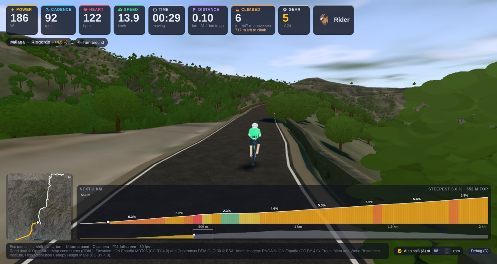
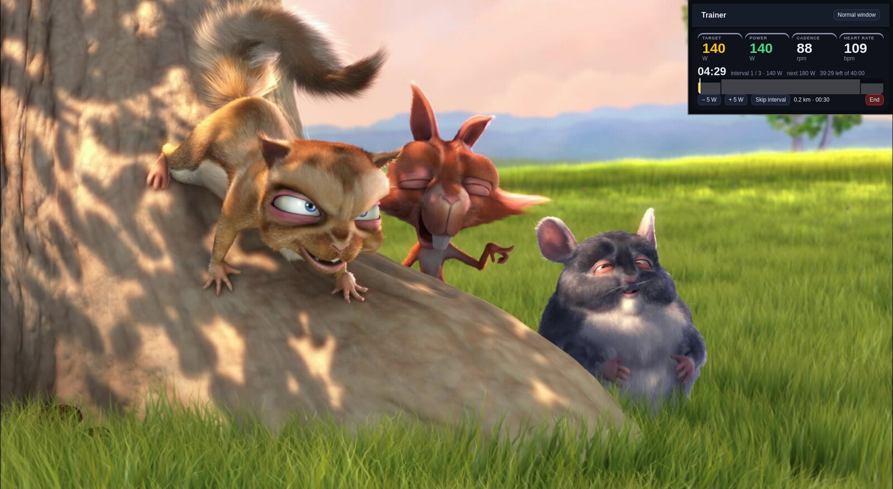
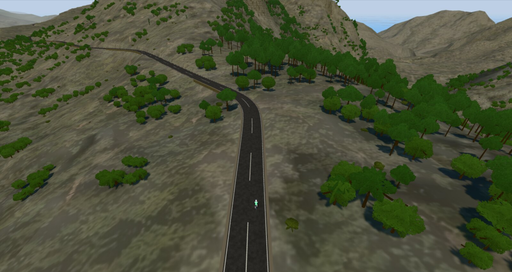
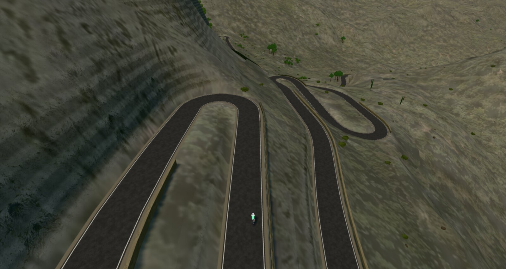
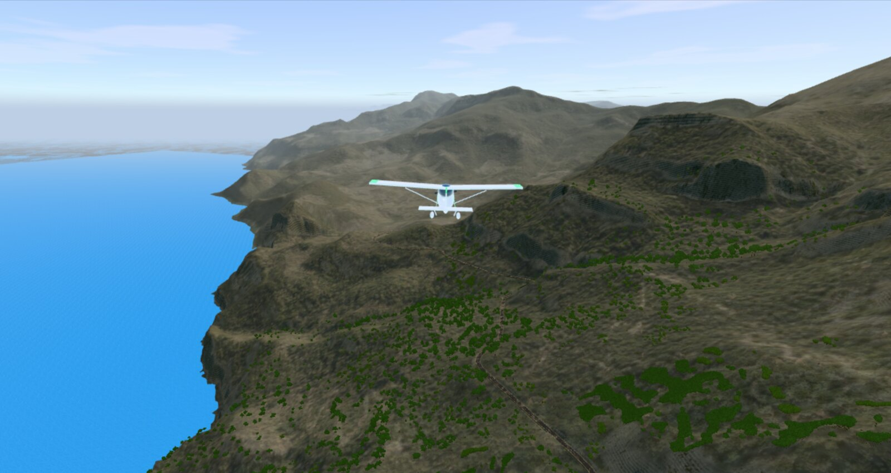
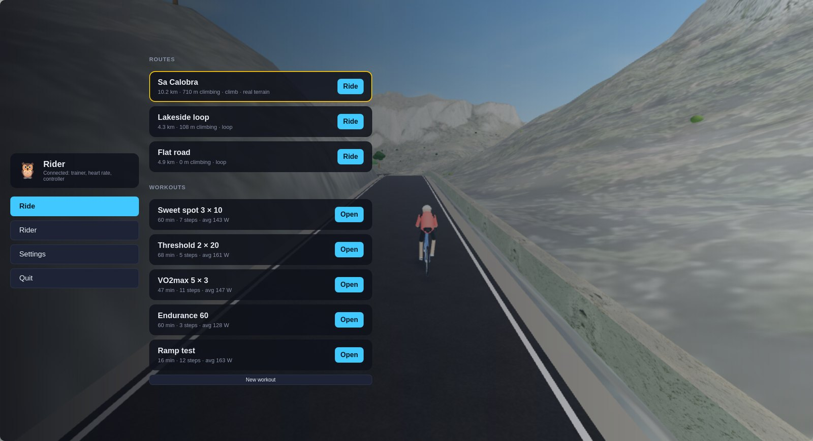

# WattsUp

[](https://github.com/rokemHB/wattsup/releases/latest)
[](https://discord.gg/d7U8qynw7s)

**Ride real climbs on your smart trainer. Use the Zwift Cog you paid for, with
no subscription.**

WattsUp is a free indoor cycling app for Linux, Windows and macOS. It talks to
your trainer, heart-rate strap and Zwift Click over Bluetooth, and the roads you
ride are real ones, with every metre of climbing taken from Spain's official
5 m terrain survey. Sa Calobra on your trainer has the same ramps and hairpins
as Sa Calobra on Mallorca.



## Why it exists

**You bought the hardware, so you should be able to use it.** A Zwift Cog with
a Click gives a single-speed trainer 24 virtual gears, but only inside a paid
subscription. WattsUp drives the same hardware itself: shift with the Click
(or the keyboard), and the trainer's resistance follows the gear and the hill
as if you had a real cassette. No account, no monthly fee, no login screen
between you and your ride.

**The climbs are real.** The roads come from OpenStreetMap and their gradients
from Spain's 5 m terrain survey, so the hairpins, the steep ramps and the
false flats are where they are on the real mountain. When the profile says
9 %, your legs will feel 9 %.

**The graphics are simple, on purpose.** There is an aerial photo draped over
real terrain and trees where real trees stand, and that's about it. What
matters on the trainer is the road under your wheels, not the shine on it.

## The small window



A lot of training happens in front of a film or a series, not a 3D world. Pick
a workout or "Free ERG", press **Small window**, and WattsUp shrinks to a strip
in the top-right corner of your screen showing your target, power, cadence,
heart rate, distance and the interval clock. It stays on top of your
fullscreen video (on macOS, not yet over another app's fullscreen Space). The trainer holds the watts in ERG mode, **+** and **−** nudge
every interval up or down, and **S** skips one. When you're done, the session
is saved like any other ride.

Workouts come as presets in percent of your FTP (including an FTP ramp test
that sets your FTP for you), or you build your own blocks of minutes at watts.

## The rest is for fun

| | |
| --- | --- |
|  |  |
|  |  |

- **Sa Calobra**: 10.2 km at 6.7 % from the port up to the Coll dels Reis,
  with the famous knot where the road crosses over itself.
- **Málaga → Riogordo**: 43 km with 1130 m of climbing, over the Puerto del
  León at 951 m.
- **The whole Serra de Tramuntana** on Mallorca: 420 km of road with the Ma-10,
  Puig Major, Coll de Sóller, Formentor, Orient, Valldemossa and the roads that
  join them, tunnels included. Pick your turns at the signed junctions, or plan
  a route on the map the way you would on komoot, and see how long it will take
  at your FTP.
- **Fly it.** Swap the bike for a small electric plane and pedal it 100 km
  along the coast from Port d'Andratx to the lighthouse at Cap de Formentor.
- **Every ride is saved**, with weekly totals and graphs, and "Export TCX"
  gives you a file to upload to Strava.

## Hardware

Built and ridden on a Wahoo KICKR CORE 2 with a Zwift Cog, a Zwift Click v2
and a Bluetooth heart-rate strap. Any trainer that speaks Bluetooth FTMS should
work, and so should a Zwift Click, Click v2, Play or Ride. If you ride without
a Cog, turn virtual gearing off in Settings and shift on your real bike.

On the Click v2 the left puck goes quiet after about a minute unless Zwift
unlocks it. WattsUp keeps it awake as well as it can, and by default the right
puck handles shifting in both directions.

## Getting it

**[Download the latest release](https://github.com/rokemHB/wattsup/releases/latest)**
for Windows, macOS (Apple Silicon and Intel) or Linux (AppImage, .deb, .rpm).
It's free and stays free.

WattsUp is early but rideable. The builds aren't signed with a paid certificate, so
Windows and macOS ask once before they open it; the release page says what to
click. What changed between versions is in [CHANGELOG.md](CHANGELOG.md).

Questions, rides to show off, or something broken? Come to the
**[WattsUp Discord](https://discord.gg/d7U8qynw7s)**. Bug reports are welcome there
or as a [GitHub issue](https://github.com/rokemHB/wattsup/issues).

To build it yourself you need Rust and Node.js (the full list per platform is in
[docs/DEVELOPMENT.md](docs/DEVELOPMENT.md#prerequisites)):

```sh
npm install
npm run tauri dev                                        # with your Bluetooth devices
WATTSUP_SIM_ONLY=1 WATTSUP_AUTO_SIM=1 npm run tauri dev  # try it with a simulated trainer
```

[docs/DEVELOPMENT.md](docs/DEVELOPMENT.md) explains how the virtual gearing
works, how the code is laid out, and how the worlds are built from open data.
[TODO.md](TODO.md) lists what's coming next, including Strava upload and riding
with friends.

## Credits

Roads © OpenStreetMap contributors (ODbL). Elevation and aerial photos © IGN
España (CC BY 4.0), the wide surroundings from Copernicus DEM GLO-30 (© ESA),
and trees from Meta and WRI's canopy height map (CC BY 4.0). The video behind
the small window is [Big Buck Bunny](https://peach.blender.org/) (© Blender
Foundation, [CC BY 3.0](https://creativecommons.org/licenses/by/3.0/)).

## License

MIT.
