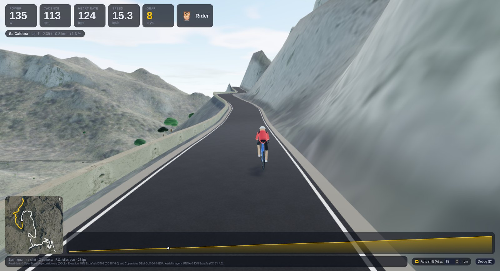
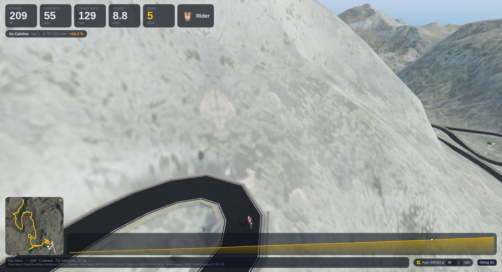
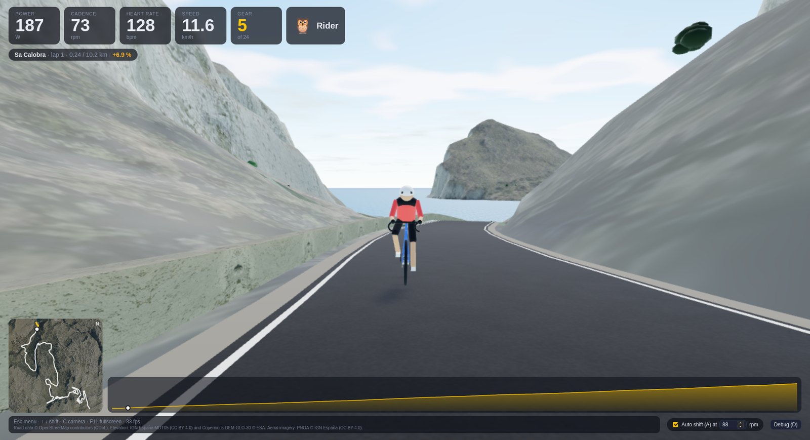
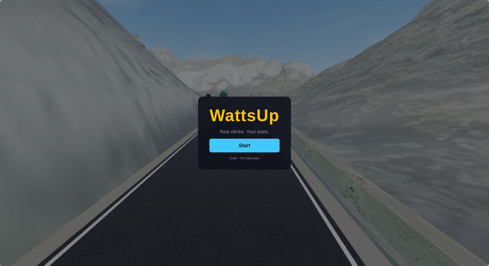
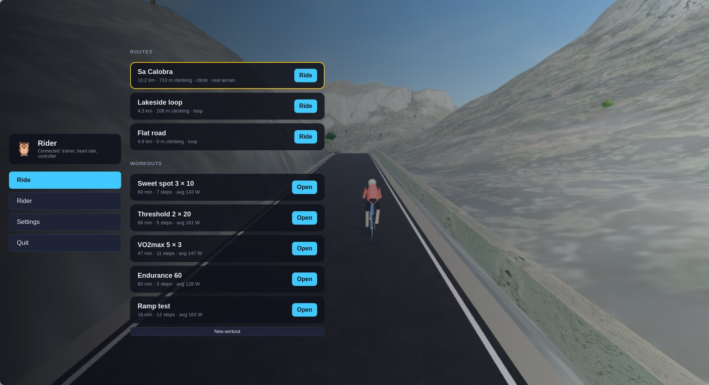

# WattsUp

A gamified indoor cycling app for smart trainers. Bluetooth FTMS, heart rate
and virtual shifting on Linux, Windows and macOS. Zwift Cog support without a
paid subscription. You might even fly.

**Status: early, but rideable.** Bluetooth devices, virtual gearing, ERG
workouts, a 3D world with the real Sa Calobra climb built from open data, a
start screen, menu, rider profile and settings. See
[HARDWARE_TESTING.md](HARDWARE_TESTING.md) for checking it against real
hardware and [TODO.md](TODO.md) for what is next.



| | |
| --- | --- |
|  |  |
|  |  |

The terrain is Spain's 5 m elevation model with the PNOA aerial photo draped
over it, the road is OpenStreetMap's Ma-2141 cut into it with stone
parapets where the ground drops away, and close-up surfaces are patches of
the same imagery at 10 cm per pixel. Everything in the pictures is built
from open data by `tools/build_route.py`; no hand-made assets yet.

Beyond the single climb, the Serra de Tramuntana is rideable: the Ma-10 and
the well-known climbs (Sa Calobra, Puig Major, Coll de Sóller, Coll de sa
Batalla, Formentor, Orient, Valldemossa, Galilea, Sant Elm) and the roads
that join them, tunnels included. On the island map, click a road and plan a
route the way you would on komoot: a start (or the destination first), as
many stops in between as you like; the route finds its own way, you drag the
line to bend it through somewhere else, and the panel shows distance,
climbing, the time it would take at your FTP, and the profile. Save it and it appears in the main menu. Or start a free ride from any
road and pick turns as you go. Terrain and imagery stream in around you (and
are cached on disk), direction signs stand at every junction, and a prompt
500 m before each junction lets you choose the turn with the arrow keys, and U
turns you around wherever you are. A route planned on the map adds a navigation
panel (next turn, distance and climbing left, time left and arrival, the time
from the road profile ahead at your average power, or at 70 % of your FTP
before a minute of riding); take another turn or turn around and the plan is
re-routed from the end of the road you chose back to the destination, or, when
there is no way, the plan ends and the road goes on as a free ride.
Every ride is kept on disk (totals plus one-second samples, under the app's
data folder) and the Rides screen shows them week by week with power, heart
rate and elevation graphs. "Export TCX" writes a ride into your Downloads
folder with power, cadence, heart rate and (for island rides) positions, ready
to upload to Strava as a virtual ride.

## What it does

- Connects to a Bluetooth smart trainer (FTMS), a heart-rate strap (HRS) and a
  Zwift Click / Click v2 / Play / Ride controller. Keyboard shifting always
  works as a fallback.
- Gives a single-speed setup like the Zwift Cog 24 virtual gears, ratio 0.9 to
  5.0 in equal percentage steps, by steering the trainer's resistance.
- Simulates a rider on a virtual road (gravity, rolling resistance, aero) and
  reports virtual speed and distance.
- Runs ERG workouts: interval protocols with presets in percent of FTP or
  your own steps, the trainer holding each step's watts, the clock only
  running while you pedal.
- Trainer mode (main menu → Trainer, or start with `--trainer`): the same
  workouts, or a quick block of minutes at watts, with nothing but the
  numbers on screen and no 3D world built. Made for training beside a
  video: target, power, cadence, heart rate, the interval clock, + and −
  to shift all watts, S to skip an interval, "Free ERG" to hold a target
  with no clock at all, and a "Small window" button that opens a small
  always-on-top window with the numbers and hides the main one until it is
  closed (its fixed size makes tiling compositors such as Hyprland float
  it). Sessions are kept in the ride list like any ride.
- Comes with simulated devices, so everything can be developed and tested
  without a trainer.

## How virtual gearing works

The trainer only knows its real drive: your chainring over the 14-tooth Cog.
For each tick WattsUp computes the force the virtual bike would need at the
wheel (virtual speed from cadence × virtual gear ratio, plus road grade), scales
it by `virtual ratio / trainer ratio` so the pedal torque comes out the same,
and converts that force into a grade for the trainer's own simulation model.
That grade is sent as an FTMS *Set Indoor Bike Simulation* command (opcode
`0x11`), clamped to the trainer's range (-10 % to +20 % on a KICKR) and flagged
when clamped.

Why SIM mode and not ERG: in SIM mode the trainer's fast internal loop keeps
the resistance right through every pedal stroke and reacts to a shift at once.
ERG would have to chase a new target power after every cadence change, which
feels sluggish and fights shifting. ERG stays a separate mode for workouts.

Commands go out at once after a shift, a mode change or a grade change, and
otherwise at most every 250 ms, only when the grade moved by more than 0.1 %,
with a resend every 5 s in case a write was lost.

The gear maths relies on three guesses about the trainer that only hardware
can confirm (its assumed rider mass, whether `cw = 0` disables its own aero,
and the real chainring). The hardware checklist has a calibration step for
each; the measured drive ratio and the model power are shown live for it.

## Architecture

```
crates/core      pure logic, no I/O: physics, gearing, resistance mapping,
                 ride session (SIM/ERG, rate limiting), FTMS / HRS / Zwift codecs
crates/devices   Trainer / HeartRateMonitor / Controller traits, DeviceProvider,
                 one DeviceEvent channel; sim/ (rider model, HR, injectable
                 controller) and ble/ (btleplug: FTMS trainer, HRS strap,
                 Zwift controllers, shared reconnect runner, raw hex logging)
crates/engine    UI-independent orchestrator: scans all providers, fills the
                 three role slots, runs the event and tick loops, publishes an
                 EngineSnapshot on a watch channel
crates/cli       wattsup-cli: scan and ride from a terminal, for hardware checks
src-tauri        Tauri v2 shell: commands plus "snapshot" events
ui/              Vite + TypeScript debug screen
```

Data flows one way: devices → `DeviceEvent` channel → engine → `RideSession`
→ `TrainerCommand` → trainer, and `EngineSnapshot` → UIs. The session has no
clock of its own (time only advances through `tick(dt)`), so it is
deterministic and can later be replayed or run server-side. A multiplayer
client will subscribe to the engine's snapshots and feed other riders in the
same way the UIs do.

Rust feature `ble` (on by default in `wattsup-devices` and `wattsup-engine`)
pulls in btleplug. The engine and the device layer build and test without it,
for machines without a Bluetooth stack:
`cargo test -p wattsup-engine --no-default-features`. The CLI and the app
always include it; use `--sim-only` there.

## Building and running

### Prerequisites

Everywhere: a stable Rust toolchain (1.80 or newer, [rustup](https://rustup.rs))
and Node.js 20 or newer with npm.

**Linux** (Debian / Ubuntu):

```sh
sudo apt install bluez libdbus-1-dev pkg-config build-essential curl wget file \
  libssl-dev libwebkit2gtk-4.1-dev libgtk-3-dev librsvg2-dev \
  libayatana-appindicator3-dev patchelf
```

Arch:

```sh
sudo pacman -S --needed bluez bluez-utils dbus pkgconf base-devel openssl \
  webkit2gtk-4.1 gtk3 librsvg libayatana-appindicator patchelf
```

Then `systemctl enable --now bluetooth`. The CLI needs only BlueZ and the
D-Bus headers; the rest is for the desktop app.

**macOS**: Xcode command line tools (`xcode-select --install`). Bluetooth
needs a permission: when running from a terminal, grant it to the terminal
app (System Settings → Privacy & Security → Bluetooth). The bundled app asks
for itself through `src-tauri/Info.plist`.

**Windows**: the [Microsoft C++ Build Tools](https://visualstudio.microsoft.com/visual-cpp-build-tools/)
and WebView2 (already part of Windows 10/11). No pairing: BLE devices are
connected directly, and the trainer must not be connected to another app.

### Desktop app

```sh
npm install
npm run tauri dev          # hot-reloading dev build
npm run tauri build        # bundles in target/release/bundle/
```

The easiest way to pass startup flags in development is the environment
variables below, e.g. `WATTSUP_SIM_ONLY=1 WATTSUP_AUTO_SIM=1 npm run tauri dev`.
(The Tauri CLI only forwards arguments after a *second* `--`, so the flag form
is `npm run tauri dev -- -- -- --sim-only`.)

### Terminal tool

```sh
cargo run -p wattsup-cli -- scan --secs 8
cargo run -p wattsup-cli -- ride --raw --trainer ble:<id> --hr ble:<id> --controller ble:<id>
cargo run -p wattsup-cli -- ride --sim-only --trainer sim:trainer --hr sim:heart-rate --controller sim:controller
```

While riding, type `u` / `d` (shift), `erg <W>`, `sim`, `grade <%>` or `q`.

### Startup flags

| App flag | Environment | CLI flag | Effect |
| -------- | ----------- | -------- | ------ |
| `--sim-only` | `WATTSUP_SIM_ONLY=1` | `--sim-only` | No Bluetooth, only simulated devices |
| `--no-sim` | `WATTSUP_NO_SIM=1` | `--no-sim` | Hide the simulated devices |
| `--raw` | `WATTSUP_RAW=1` | `--raw` | Log every Bluetooth packet as hex |
| `--auto-sim` | `WATTSUP_AUTO_SIM=1` | | Connect the simulated trainer, strap and controller at startup |
| `--route <id>` | `WATTSUP_ROUTE=<id>` | | Built-in route to ride: `sa-calobra` (default), `malaga-colmenar` or `lakeside` |
| `--start <m>` | `WATTSUP_START_M=<m>` | | Start that many metres along the route (to look at a spot) |
| `--camera <mode>` | `WATTSUP_CAMERA=<mode>` | | Start in the `chase`, `side`, `front` or `drone` view |
| `--trainer` | `WATTSUP_TRAINER=1` | | Open the trainer screen (ERG only, no 3D world) |

The CLI also honours `RUST_LOG` (`RUST_LOG=debug` shows btleplug's own logging).

## Worlds and routes

### The island

`tools/build_network.py` builds a region as a road network: a whitelist of
road refs (`--refs`, plus the roundabouts, short links and shortest runs of
other roads that join them; without it every road from OSM `primary` to
`unclassified`) as a graph with
10 m sampled geometry, elevation from the 5 m model, and sign destinations
at junctions (OSM `destination` tags, else the nearest towns along the
graph). It also writes the coarse far layer and the island map. The
Tramuntana network (420 km of road, 692 signed junctions; tunnels are
their own edges and run straight between their portals) is compiled into
the core crate; terrain and imagery around the rider are fetched at ride
time from the IGN services through the app's disk cache
(`~/.cache/wattsup/` on Linux, the app cache directory elsewhere).

```sh
# the OSM extract: Overpass (see above) or, when Overpass is at capacity, a Geofabrik PBF
curl -L -o baleares.osm.pbf https://download.geofabrik.de/europe/spain/islas-baleares-latest.osm.pbf
.venv/bin/pip install osmium
.venv/bin/python tools/pbf_extract.py baleares.osm.pbf tramuntana.json --bbox 39.50,2.33,39.99,3.25
# the 5 m model in 0.05° chunks (the WCS caps one request at about 0.1°), into dem5/
# then the network, far layer, middle layer, map and world metadata
.venv/bin/python tools/build_network.py --osm tramuntana.json --dem-dir dem5 \
  --dem dem_n39_e002.tif dem_n39_e003.tif --id mallorca --name Mallorca --ortho \
  --refs Ma-10,Ma-11,Ma-11A,Ma-2141,Ma-2130,Ma-2131,Ma-2210,Ma-2220,Ma-2200,Ma-2100,Ma-1110,Ma-1101,Ma-1100,Ma-1032,Ma-1041,Ma-1040,Ma-1043,Ma-1016,Ma-1031,Ma-1030
# the middle layer alone (a 45 m height grid over the roads' region, int16, for the
# mid-distance blocks the app builds at ride time with zoom-14 imagery):
.venv/bin/python tools/build_mid.py --id mallorca --dem dem_n39_e002.tif dem_n39_e003.tif
```

Trees stand where the real ones do. `tools/build_trees.py` finds tree tops
(local maxima, with a window that grows with crown width) in Meta and the
World Resources Institute's 1 m canopy height model (CC BY 4.0, zoom-9
quadkey tiles on AWS Open Data) within 1.1 km of the roads, and writes each
tree's position and height, 4 bytes a tree, gzip-compressed, to
`ui/public/worlds/mallorca-trees.bin.gz` (2.07 million trees, 6.5 MB). The
model merges neighbouring crowns of a closed wood into one top (about 50 a
hectare where the orthophoto shows 300 and more), so the renderer widens each
crown into its share of the space and, near the rider, fills the rest with
smaller trees (`ui/src/world/forest.ts`).

```sh
.venv/bin/pip install rasterio scipy
for q in 122000031 122000102 122000120; do   # Mallorca; 122000013 is open sea
  curl -o ~/wattsup-data/canopy/chm_$q.tif \
    https://dataforgood-fb-data.s3.amazonaws.com/forests/v1/alsgedi_global_v6_float/chm/$q.tif
done
.venv/bin/python tools/build_trees.py --reach 1100 --network crates/core/worlds/mallorca/network.json \
  --chm ~/wattsup-data/canopy/chm_*.tif --out ui/public/worlds/mallorca-trees.bin.gz
```

### Single routes

Three routes ship with the app. *Lakeside loop* is a procedural 4.3 km test
course. *Sa Calobra* is the real road from the Port de Sa Calobra up to the
Coll dels Reis on Mallorca, 10.2 km at 6.7 % average. *Málaga → Riogordo* is
a 5 km flat, straight warm-up through the city (made up, with houses along
it), then the A-7000 from Ciudad Jardín over the Puerto del León (951 m)
through Colmenar and the A-7204 down to Riogordo, 43 km with 1130 m of
climbing. Both real roads are built from open data:

- road geometry from OpenStreetMap (© OpenStreetMap contributors, ODbL),
- elevation near the route from Spain's IGN 5 m terrain model MDT05 (CC BY 4.0),
  fetched through the IDEE INSPIRE WCS,
- elevation for the wide surroundings from the Copernicus DEM GLO-30 (© ESA),
  a 30 m surface model,
- aerial imagery from Spain's PNOA (© IGN España, CC BY 4.0) through the IGN
  WMTS, draped over the terrain.

`tools/build_route.py` turns those into a route file for the Rust core
(`crates/core/routes/<id>.json`, a point every 5 m with elevation) and two
heightmaps for the renderer (`ui/public/worlds/<id>-near.bin` at 15 m around
the route, `<id>-far.bin` at 150 m over 36 km). To rebuild Sa Calobra or make
another road:

```sh
python -m venv .venv && .venv/bin/pip install -r tools/requirements.txt
# the road: an Overpass query with `out geom;`, e.g. all ways tagged ref=Ma-2141 in a bounding box
curl -A 'WattsUp route builder' -o sa_calobra.json -X POST https://overpass-api.de/api/interpreter \
  --data-urlencode 'data=[out:json];way["highway"]["ref"="Ma-2141"](39.80,2.74,39.90,2.86);out geom;'
# the wide-area elevation tile (1° x 1°, named after its south-west corner)
curl -o dem.tif https://copernicus-dem-30m.s3.amazonaws.com/Copernicus_DSM_COG_10_N39_00_E002_00_DEM/Copernicus_DSM_COG_10_N39_00_E002_00_DEM.tif
# the 5 m model for the route and its surroundings (Spain only; a GeoTIFF in EPSG:4326)
curl -A 'WattsUp route builder' -o ign5.tif 'https://servicios.idee.es/wcs-inspire/mdt?service=WCS&request=GetCoverage&version=2.0.1&coverageId=Elevacion4258_5&subset=Lat(39.800,39.880)&subset=Long(2.755,2.850)&format=image/tiff'
.venv/bin/python tools/build_route.py --osm sa_calobra.json --dem dem.tif --dem-fine ign5.tif \
  --id sa-calobra --name "Sa Calobra" --cut-at-top --smooth 5 --min-grade -6 --ortho
```

A longer road spans more than one 5 m request (the WCS caps a request at
about 0.1°): fetch overlapping chunks and pass them all to `--dem-fine`, as
for Málaga → Colmenar (the chunks overlap by 0.005° so no seam is left bare):

```sh
curl -A 'WattsUp route builder' -o a7000.json -X POST https://overpass.kumi.systems/api/interpreter \
  --data-urlencode 'data=[out:json];way["highway"]["ref"="A-7000"](36.68,-4.55,36.96,-4.25);out geom;'
curl -o dem.tif https://copernicus-dem-30m.s3.amazonaws.com/Copernicus_DSM_COG_10_N36_00_W005_00_DEM/Copernicus_DSM_COG_10_N36_00_W005_00_DEM.tif
# six overlapping 5 m chunks of 0.1° × 0.065° covering Málaga, the pass, Riogordo and the warm-up
# the A-7204 to Riogordo comes from a second query (ref A-7204) merged into the same JSON
.venv/bin/python tools/build_route.py --osm malaga_riogordo.json --dem dem.tif --dem-fine ign5_A.tif ign5_B.tif ign5_C.tif ign5_D.tif ign5_E.tif ign5_F.tif \
  --id malaga-colmenar --name "Málaga → Riogordo" --from 36.7337,-4.4158 --to 36.9167,-4.2917 \
  --lead-in 5000 --lead-in-bearing 250 --urban "0,5600,3,7;5600,7200,2,4" \
  --smooth 5 --near-spacing 20 --band-spacing 10 --ortho --ortho-blocks 6 --ortho-zoom 15
```

`--from`/`--to` pick the road nodes nearest those coordinates (default: the
lowest and highest ends of the ways), `--via` forces the path through
points in order, `--merge` collapses split carriageways. `--lead-in` adds a
flat, straight, made-up stretch before the start, arriving from
`--lead-in-bearing`, with the ground within 250 m levelled to it; `--urban`
marks stretches (metres along the final route) that get houses on both sides.

`--ortho` fetches about 300 map tiles (cached under `~/.cache/wattsup/tiles`)
and writes 16 photo textures of 1024 px for the near grid plus one for the
far grid, about 3.6 MB per route. The IGN tile server answers 502 now and
then; the script retries with backoff.

The script chains the OSM way segments into one path from the lowest to the
highest end (`--cut-at-top` stops at the summit), resamples it every 5 m,
reads the elevation from the fine model, smooths it lightly and caps the
grade as a safety net. `--dem-fine` is optional: without it the 30 m surface
model is used for everything, which is tens of metres off on a cliff road
with stacked hairpins, so use `--smooth 15` there and expect a plausible
rather than exact profile. Outside Spain, any GeoTIFF in geographic
coordinates works as the fine model.

## Tests

```sh
cargo fmt --all --check
cargo clippy --workspace --all-targets -- -D warnings
cargo test --workspace
npx tsc --noEmit
npx vitest run
```

The Rust tests cover the physics, gearing and resistance maths, the byte-level
codecs, the session's command timing, automatic shifting, the routes and an
end-to-end ride on the simulated devices. The UI tests cover the formatting
helpers and the route geometry. CI runs all of this on
Ubuntu, Windows and macOS and builds the desktop bundles for each.

## License

MIT.
